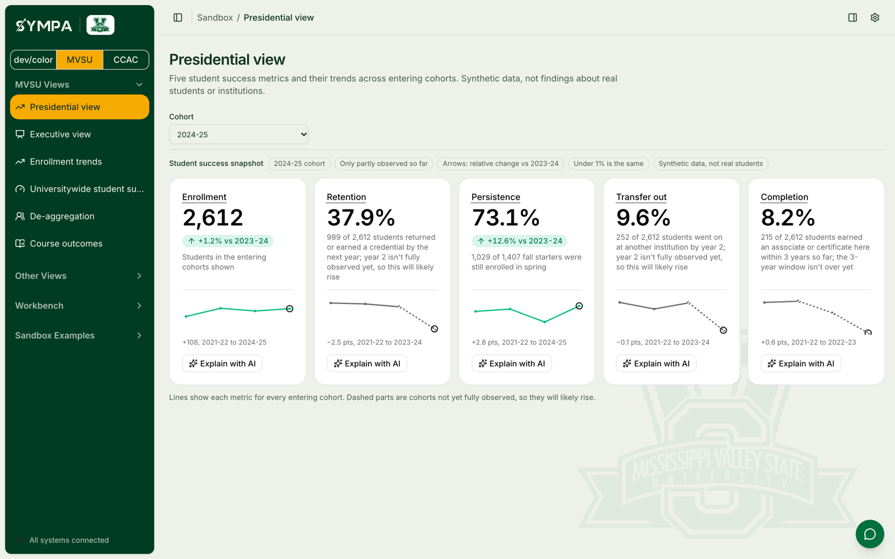
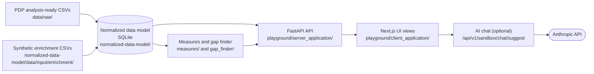

# SYMPA: Student Yearly Momentum & Performance Analytics

> **Status: not maintained.** Built during the 2026 Higher Endeavor Datathon and released as-is
> under the MIT License. We don't accept issues or pull requests. To build on it, fork it.

SYMPA helps a college or university see how its students are doing and where groups of students
are falling behind. It reads the student and course files an institution already sends to the
Postsecondary Data Partnership (PDP), and turns them into web pages for presidents, deans, faculty
and advisors: enrollment and retention over time, gateway course completion, credentials earned,
course pass rates, and the largest gaps between groups of students, with small groups hidden to
protect privacy. An optional AI chat answers questions about what the numbers mean. Everything here
runs on synthetic (made-up) student records, so nothing in it is a finding about real students or a
real institution.



## Architecture



- **Normalized data model** ([normalized-data-model/](normalized-data-model/README.md)): maps,
  fixes, validates and loads the two PDP files and the enrichment files into one set of tables.
- **Measures and gap finder** ([measures/](measures/README.md), [gap_finder/](gap_finder/README.md)):
  compute the success measures for each group and rank each group's gap from everyone else,
  hiding groups under 10 students. `python -m measures.publish` saves them to
  `measures/output/success_measures.sqlite`, with each single cohort's change from the one before
  (`measure_trends`), so the chat's `query_results` can confirm every KPI tile's value and trend
  arrow except graduation rate, which comes from institution records, not PDP.
- **API** ([playground/server_application/](playground/server_application/README.md)): one
  FastAPI module per view, under `app/sandbox/`. It reads the published results, and counts the
  rest live from the data model loaded into its own database.
- **UI** ([playground/client_application/](playground/client_application/README.md)): the views,
  the Workbench (upload and explore the files) and the chat panel.
- **AI chat**: runs in the API. It sends the question, with aggregate counts and column
  definitions, never student records, to the Anthropic API.
- Also here: a read-only [MCP server](mcp/README.md) that describes the data model to AI coding
  tools, and a [log of mock-data issues](data/quality/README.md).

More detail, including where each measure is computed: [docs/architecture.md](docs/architecture.md).

## Prerequisites

| Tool | Version | How to get it |
| --- | --- | --- |
| macOS or Linux | macOS 26; CI runs on Ubuntu | Windows is untested: see [known issues](docs/known-issues.md) |
| Git | Any | `xcode-select --install` on macOS |
| [mise](https://mise.jdx.dev) | Tested with 2026.11.10 | `brew install mise` |
| Python | 3.14.10 (3.10 to 3.14 work for the root packages; 3.15 doesn't, as pyarrow has no wheel for it yet) | Installed by mise |
| Node | 24.22.3 | Installed by mise |
| bun | 1.4.3 | Installed by mise |
| uv | 0.13.9 | Installed by mise |
| Disk | About 2 GB free | The published measures file alone is about 650 MB |

mise reads the versions from [playground/mise.toml](playground/mise.toml). No Docker is needed.

Tested with macOS 26 on 2026-11-18: Python 3.14.10, Node 24.22.3, bun 1.4.3, uv 0.13.9.

## Quick start

From a fresh clone to the web app on the bundled mock data, on SQLite. It takes about 10 minutes,
most of it installing packages and publishing the measures.

```bash
git clone <repository-url> sympa
cd sympa

# 1. Toolchain: bun, Node, Python and uv, at the versions in playground/mise.toml
cd playground
mise trust && mise install

# 2. Python packages for the data model and measures, in .venv/ at the repo root
mise exec -- python -m venv ../.venv
cd ..
source .venv/bin/activate
python -m pip install -r requirements.txt

# 3. Build the data model from the mock files, then publish the measures and gaps
(cd normalized-data-model && python -m src.loader.load)
python -m measures.publish

# 4. The Playground app, on SQLite
cd playground
mise run db:choose sqlite
mise run api:install
mise run web:install
```

Start the API in one terminal and the web app in a second, both from `playground/`:

```bash
mise run api:dev    # http://localhost:8000, applies migrations first
```

```bash
mise run web:dev    # http://localhost:3000
```

On Windows, see the **On Windows?** notes in
[playground/README.md](playground/README.md#how-to-run-it-locally) first: mise needs Git Bash, and
the virtual environment activates with `.venv\Scripts\activate`.

Then load the mock data into the app's database, in a third terminal. This is the same as clicking
**Use the mock files** on the Workbench's Upload page (http://localhost:3000/workbench/upload):

```bash
curl -X POST http://localhost:8000/api/v1/sandbox/pipeline/runs \
  -H 'Content-Type: application/json' -d '{}'
```

In PowerShell, use `curl.exe` on one line with `-d "{}"`, or click **Use the mock files** instead.

The load takes about two minutes. Its status is at
`http://localhost:8000/api/v1/sandbox/pipeline/runs/<run_id>`, with the `run_id` the command
printed; wait for `"status":"succeeded"`. Then open http://localhost:3000, pick a university and
open a view. Press `Ctrl+C` in each terminal to stop.

The AI chat is off until you add a key: see [Environment variables and keys](#environment-variables-and-keys).
Every other page works without one.

### Run the tests

The data check and the foundations' tests, from the repo root with `.venv` active:

```bash
source .venv/bin/activate
make check          # a few minutes; make check-fast skips the slow tests
```

`make check` runs `python scripts/check.py`, which checks that each CSV in `data/raw/` matches
[data/manifest.json](data/manifest.json) and that the table under
[Swapping in your own PDP files](#swapping-in-your-own-pdp-files) matches the manifest. Then it
runs the tests for the data model, the MCP server, the measures and the gap finder.

| What you see | What it means | What to do |
| --- | --- | --- |
| `Python packages are missing or out of date` | `requirements.txt` isn't installed in the active Python | `python -m pip install -r requirements.txt` |
| `FAIL: data/raw/...: does not match data/manifest.json` | A data file changed | Undo the change, or see [Swapping in your own PDP files](#swapping-in-your-own-pdp-files) |

`make check` doesn't cover the Playground. Its checks, from `playground/`:

```bash
mise run api:lint
mise run api:test-sqlite
mise run web:install
mise run web:lint
```

Without `make` (on Windows, for example), run `python scripts/check.py`,
`python data/quality/run_checks.py`, then `python -m pytest -q` in each of
`normalized-data-model/`, `mcp/`, `measures/` and `gap_finder/`.

## Swapping in your own PDP files

The bundled files are synthetic mock data in the shape of PDP's analysis-ready files. See
[data/README.md](data/README.md) for where they came from and the rules for real data.

| File | Rows | Columns | What it is |
| --- | ---: | ---: | --- |
| [pdp_cohort_data.csv](data/raw/pdp_cohort_data.csv) | 10,313 | 85 | One row per student. Dictionary: [cohort](data/dictionaries/arf_cohort_data_dictionary.md) |
| [pdp_course_data.csv](data/raw/pdp_course_data.csv) | 100,951 | 35 | One row per student per course per term. Dictionary: [course](data/dictionaries/arf_course_data_dictionary.md) |

The column names are shortened; [column_lookup.csv](data/dictionaries/column_lookup.csv) maps
each one to its dictionary name and description.

> [!CAUTION]
> A real PDP export holds student records protected by FERPA. **Never commit it.** The two files
> above are tracked by git, so `.gitignore` doesn't protect them if you overwrite them. Keep a real
> export in `data/private/`, which git ignores, unless you're sure your copy of the repo stays
> private and you never push it.

To use your own export:

1. **Put the files in place.** Name them `pdp_cohort_data.csv` and `pdp_course_data.csv`. Either
   keep them in `data/private/`, or overwrite `data/raw/pdp_cohort_data.csv` and
   `data/raw/pdp_course_data.csv`, with the caution above.
2. **Deal with the enrichment files.** The files in `normalized-data-model/data/input/enrichment/`
   are made up for the mock students (except `institution_events.csv`, a list of public events), so none of them match your students, and the loader holds
   their rows back. Remove the ones you don't have from the `sources` in
   `normalized-data-model/config/pipeline.yaml`, which both the loader and the app read, or
   replace them with your own data. See
   [Load your own enrichment files](normalized-data-model/README.md#load-your-own-enrichment-files).
3. **Check the mock-data fixes.** `normalized-data-model/config/data_fixes.yaml` fixes known
   bugs in the mock files. Read it, and keep only the fixes your files need.
4. **Rebuild the data model and publish.** From the repo root:
   `(cd normalized-data-model && python -m src.loader.load --cohort ../data/private/pdp_cohort_data.csv --course ../data/private/pdp_course_data.csv)`
   (leave out both flags if you overwrote `data/raw/`), then `python -m measures.publish`.
5. **Reload the app.** Upload the two files on the Workbench's Upload page, which checks their
   columns first, or, if you overwrote `data/raw/`, run the `curl` command from
   [Quick start](#quick-start). Then restart `mise run api:dev`.
6. **If you overwrote the files in `data/raw/`,** `make check` fails until you run
   `python scripts/check.py --update` and update the table above to the new counts. The
   foundations' tests are written against the mock data, so some of them fail on real data.

## Environment variables and keys

Only `DATABASE_URL` is required, and `mise run db:choose sqlite` sets it. Every server setting,
with a placeholder, is in
[playground/server_application/.env.example](playground/server_application/.env.example); the
web app's are in [playground/client_application/.env.example](playground/client_application/.env.example).

**Server** (FastAPI). Put local values and secrets in
`playground/server_application/.env.development.local`, which git ignores. The committed
`.env.development`, `.env.staging` and `.env.production` hold non-secret defaults.

| Variable | Required? | What it does | Where to get it |
| --- | --- | --- | --- |
| `DATABASE_URL` | Required | The app's database, which also holds the loaded data model | `mise run db:choose sqlite` writes `sqlite:///./playground_dev.db` |
| `APP_ENV` | Optional | `development` (default), `staging` or `production`; picks which `.env.<APP_ENV>` files load | Your choice |
| `ANTHROPIC_API_KEY` | Optional | Turns the AI chat on. Without it the chat panel says the chat is off and how to turn it on, and nothing else changes | [console.anthropic.com](https://console.anthropic.com), API keys. Set a spending limit |
| `SANDBOX_CHAT_MODEL` | Optional | The Anthropic model the chat calls. Default `claude-sonnet-5-5` | Anthropic's model list |
| `SANDBOX_CHAT_ENABLED` | Optional | `false` turns the chat off even with a key. Default `true` | Your choice |
| `SANDBOX_ENABLED` | Optional | Serves the views, Workbench and pipeline endpoints. Default `true`; `.env.production` sets `false` | Your choice |
| `CORS_ORIGINS` | Optional | Browser origins allowed to call the API, as a JSON list | `.env.development` allows `http://localhost:3000` |
| `PIPELINE_UPLOAD_MAX_BYTES` | Optional | Largest Workbench upload. Default 100 MB | Your choice |
| `RESULTS_DB`, `DEAGGREGATION_DB` | Optional | Path to the published measures file. Default `measures/output/success_measures.sqlite` | Written by `python -m measures.publish` |
| `DATABASE_ECHO`, `DATABASE_POOL_SIZE`, `DATABASE_MAX_OVERFLOW` | Optional | SQL logging and the PostgreSQL connection pool | Your choice |
| `PROJECT_NAME`, `VERSION`, `API_V1_PREFIX` | Optional | What the API reports, and its URL prefix (`/api/v1`) | Leave as is |
| `AUTO_MIGRATE` | Optional | `false` stops `mise run api:dev` applying migrations first | Your shell or `playground/mise.local.toml` |

**Web app** (Next.js). Copy `playground/client_application/.env.example` to `.env.local`. Each
has a default in `src/lib/env.ts`, and `NEXT_PUBLIC_` values are built into the page, so restart
or rebuild after a change.

| Variable | Required? | What it does |
| --- | --- | --- |
| `NEXT_PUBLIC_API_BASE_URL` | Optional | Where the API is. Default `http://localhost:8000/api/v1` |
| `NEXT_PUBLIC_APP_ENV` | Optional | `development`, `staging` or `production` |
| `NEXT_PUBLIC_SANDBOX_ENABLED` | Optional | Shows the views. On by default, except in production builds |
| `NEXT_PUBLIC_REPOSITORY_URL` | Optional | The source repository the landing page links to. Set it to your copy |
| `NEXT_PUBLIC_REPOSITORY_FOLDER` | Optional | The app's folder in that repository. Default `playground` |

**Data model, measures and MCP server** (repo root). None are needed on SQLite.

| Variable | Required? | What it does |
| --- | --- | --- |
| `PDP_POSTGRES_URL` | Only for `python -m src.loader.load --backend postgres` | The PostgreSQL URL the loader writes to. The name is set by `postgres.url_env` in `normalized-data-model/config/pipeline.yaml` |
| `PDP_MCP_ACCESS_MODE`, `PDP_MCP_BACKEND`, `PDP_MCP_SQLITE_PATH`, `PDP_MCP_POSTGRES_URL`, `PDP_MCP_RESULTS_PATH`, `PDP_MCP_LOG_LEVEL` | Optional | The MCP server's mode, database and logging. See [mcp/README.md](mcp/README.md) |
| `PDP_TEST_POSTGRES_URL`, `PDP_REQUIRE_POSTGRES` | Optional, tests only | Run the PostgreSQL tests against this URL; `1` makes a skipped one fail |
| `PYTEST_WORKERS`, `PYTEST_ARGS` | Optional, `make` only | Test workers (default 4) and extra pytest arguments |

## Deploy options

There's no hosted copy: bring your own host. Setup varies by host, and none of it is needed to run
locally.

**To run it at your institution with real student data, follow [Host it yourself](docs/self-hosting.md).**
The app has no login, and one endpoint returns student-level rows, so it must sit behind your
sign-on. That guide covers it, plus production settings, the reverse proxy, where student data is
stored and how to delete it.

What any host needs:

- **Two services:** the Next.js app (`playground/client_application/`) and the FastAPI app
  (`playground/server_application/`, entry point `app.main:app`). Point the web app at the API
  with `NEXT_PUBLIC_API_BASE_URL`, and allow the web app's address in `CORS_ORIGINS` if they're
  on different addresses.
- **The data, built before the upload.** The databases are generated, not committed.
  [playground/deploy/build_data.sh](playground/deploy/build_data.sh) loads the data model, adds the
  app's tables, publishes the measures and trims the measures file to fit a size limit.
- **Settings:** `APP_ENV=staging` (production turns the views off), `SANDBOX_ENABLED=true`,
  `NEXT_PUBLIC_SANDBOX_ENABLED=true`, and `DATABASE_URL` and `DEAGGREGATION_DB` pointing at the
  built files. On a self-hosted server whose disk is writable, a Workbench run replaces the file
  `DEAGGREGATION_DB` points at with a freshly published, full-size one (about 650 MB, not trimmed).
- **The chat on a public site:** anyone with the link can spend your key. Leave
  `ANTHROPIC_API_KEY` unset, or set a spending limit on it.

The repo has one worked example, for Vercel: [vercel.json](vercel.json), [.vercelignore](.vercelignore)
and [playground/deploy/](playground/deploy/). From the repo root, with the Vercel CLI logged in and
the project linked, `playground/deploy/deploy.sh https://your-project.example.com` builds the
data, deploys, and checks every page with
`python playground/deploy/check_site.py https://your-project.example.com`. Either script also
reads the address from `SITE_URL`, and `VERCEL_SCOPE` picks a Vercel team.

## Customizing the GUI

All of these are in `playground/client_application/src/`.

- **Reorder or hide pages.** [content/sandbox-examples.ts](playground/client_application/src/content/sandbox-examples.ts)
  lists every view (`proofOfConceptItems`), the order each university's side menu shows them
  in (`ccacViewItems`, `mvsuLeadingHrefs`, `mvsuHiddenHrefs`), and the landing page's role groups
  (`ROLES`). Page addresses are in [lib/routes.ts](playground/client_application/src/lib/routes.ts).
- **The university toggle** (dev/color, MVSU, CCAC). `UNIVERSITIES` in
  [lib/theme.ts](playground/client_application/src/lib/theme.ts) lists the options and the theme
  each one uses; the toggle itself is
  [components/university-toggle.tsx](playground/client_application/src/components/university-toggle.tsx).
  `viewSectionsFor` and `startPageFor` in `content/sandbox-examples.ts` decide which views each
  one lists and where **Get started** goes. dev/color shows every view.
- **Themes.** `PALETTES` in `lib/theme.ts` lists the color themes in the settings menu, and each
  has a `:root[data-palette="..."]` block, light and dark, in
  [app/globals.css](playground/client_application/src/app/globals.css). `CHART_PALETTES` and the
  `data-chart-palette` blocks do the same for chart colors.
- **Add a logo.** Put the logo and a single-color watermark copy in
  `playground/client_application/public/brand/`, add an entry with their pixel sizes to `logos` in
  [content/brand.ts](playground/client_application/src/content/brand.ts), and pick it for a theme in
  `brand.logo`. The product name, tagline and footer credit are in the same file.

## Uploads and more data

- **The Workbench** (http://localhost:3000/workbench/upload) takes a cohort CSV and a course CSV,
  checks their columns, and loads them with the data model's own loader into the app's database.
  **Use the mock files** loads the bundled files instead. Each load replaces the data model's
  tables. For a quick try, upload the 10-student sample files in
  `normalized-data-model/data/input/sample/`. To see how bad files are refused, run
  `python playground/scripts/make_upload_test_files.py`; it writes one folder of files per failure
  case to `normalized-data-model/output/playground/upload_test_files/`.
- **One run updates every view.** After the tables load, the run also rebuilds the published
  results (`python -m measures.publish`), which takes about a minute longer. De-aggregation,
  Course outcomes, Aid momentum and the Executive view's unfiltered tiles and gaps then show the
  new data, with no restart. The rebuild needs the uploaded files to cover the cohort years
  2021-22 to 2024-25, which `measures/manifest.yaml` publishes. If one is missing, the tables
  still load, those four views keep the earlier results, and the run's last line says which year.
  On a read-only deploy the rebuild is skipped, and the run says so.
- **Supplemental data:** a CSV with a `Student_GUID` column and any value columns (template:
  `playground/client_application/public/templates/supplemental_template.csv`). Each value column
  becomes a student attribute. Columns that name a person (name, SSN, address, email, phone, birth
  date) are refused.
- **Uploads are kept on disk,** in `normalized-data-model/data/uploads/` (git-ignored). On a demo
  or serverless deploy the disk is read-only or wiped between requests, so uploads and loads
  don't work or don't persist there. Run the app locally to use them.
- **More enrichment data that loads every time:** add a CSV and a mapping config to
  `normalized-data-model/`, as in [Load your own enrichment files](normalized-data-model/README.md#load-your-own-enrichment-files),
  then rebuild, publish and reload as in steps 4 and 5 of [Swapping in your own PDP files](#swapping-in-your-own-pdp-files).
  More on uploads: [playground/README.md](playground/README.md#step-8-try-the-workbench).

## Known issues

- The mock data has quirks, such as two students in two cohorts each and course years well
  outside the cohort years.
- Uploads only persist when the app runs locally.
- The chat needs your own Anthropic key, and on a public site anyone can spend it.
- Windows, PostgreSQL for the app, and real PDP exports are untested or lightly tested.
- Some enrichment data is synthetic with planted effects, so don't report results by those fields.

The full list: [docs/known-issues.md](docs/known-issues.md).

## Credits

Built by the CCA squad: Andrew Gatdula (squad lead), Anthony Bibbs, Ayo Akala and Ben Makusha.

The shared foundations (the normalized data model, gap finder, MCP server and Playground starter)
came from the datathon's starter repository, built by fellows across squads.

The mock data is from [Achieving the Dream](https://achievingthedream.org/), for the Postsecondary
Data Partnership. Mississippi Valley State University and the Community College of Allegheny County
gave permission for their names and logos to appear: see [docs/permissions.md](docs/permissions.md).

## License

The code is under the [MIT License](LICENSE). The data in `data/` isn't covered by it: see
[data/README.md](data/README.md#terms). The university names and logos are used with permission
and aren't covered by it either.

## About the 2026 Higher Endeavor Datathon

This project was built by /dev/color fellows at the 2026 Higher Endeavor Datathon, with partner
institutions Mississippi Valley State University (MVSU) and the Community College of Allegheny
County (CCAC). It runs on synthetic data and is released as-is.
