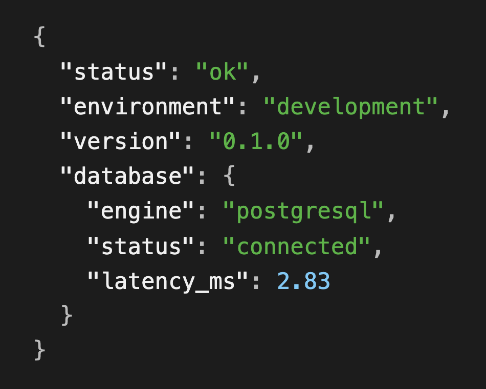
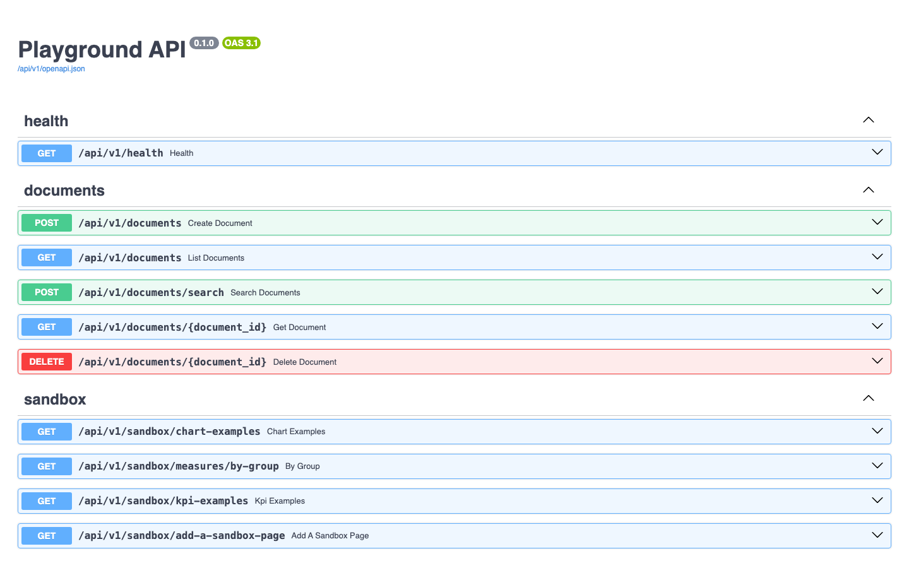
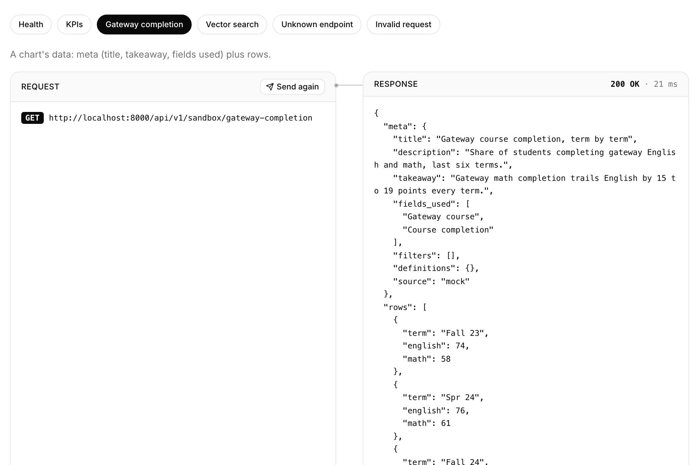

# Server Application

The FastAPI back end for Playground; it serves the [Client Application](../client_application/README.md)
and deploys on its own with just this folder and a `DATABASE_URL`.

## Layout

```
app/
├── main.py               # create_app(): middleware, routers, lifespan
├── core/config.py        # Settings, resolved from APP_ENV
├── core/errors.py        # One JSON shape for every error
├── db/base.py            # Base (naming convention), UUIDv7 + timestamp mixins
├── db/session.py         # Async engine, get_session dependency
├── db/types.py           # Embedding: pgvector on PostgreSQL (default), JSON on SQLite
├── models/               # SQLAlchemy models (import each in models/__init__.py)
├── schemas/              # Pydantic request/response models
├── services/             # Business logic; routes stay thin
├── api/dependencies.py   # SessionDep, EmbedderDep: shared by every route module
├── api/v1/routes/        # HTTP endpoints
└── sandbox/              # Mock-data endpoints, one folder per sandbox page
    ├── router.py         #   Mounts every sandbox page (off in production)
    ├── shared.py         #   ChartMeta, ChartResponse, Kpi: shared by every page
    ├── chart_examples/   #   /sandbox/chart-examples: the same three files
    ├── measures/         #   /sandbox/measures: routes.py, schemas.py, results.py
    ├── kpi_examples/     #   /sandbox/kpi-examples: the same three files
    └── add_a_sandbox_page/  #   /sandbox/add-a-sandbox-page: the same three files
alembic/                  # Migrations (config in pyproject.toml [tool.alembic])
tests/
```

## How to run it locally

From the repo root:

```bash
mise run db                                  # start the database first
mise run api:install && mise run api:dev     # http://localhost:8000
```

Health check: http://localhost:8000/api/v1/health



Every endpoint, ready to try: http://localhost:8000/docs



### Database migrations

`api:dev` applies pending migrations first, in local development only; staging and production migrate
as a deploy step. To skip them once:

```bash
AUTO_MIGRATE=false mise run api:dev
```

To skip them always, add this to a git-ignored `mise.local.toml` at the repo root:

```toml
[env]
AUTO_MIGRATE = "false"
```

## Environments

`APP_ENV` picks `development` (default), `staging` or `production`; settings then load from
`.env.<APP_ENV>` (committed defaults), `.env.<APP_ENV>.local` (git-ignored secrets) and real environment
variables, which always win. `postgres://` URLs from hosts are converted to the async driver.

## Commands (from the repo root)

| Command | What it does |
|---|---|
| `mise run api:install` | Install dependencies (`uv sync`) |
| `mise run api:dev` | Apply pending migrations, then run with reload on http://localhost:8000 |
| `mise run api:test` | Run tests on the chosen database (`mise run db:choose`; PostgreSQL by default) |
| `mise run api:test-sqlite` | Run tests on SQLite, whichever database is chosen |
| `mise run api:lint` / `api:format` | Ruff lint / auto-fix + format |
| `mise run api:migrate` | Apply migrations |
| `mise run api:migrate-down` | Roll back one migration |
| `mise run api:migration "..."` | Autogenerate a migration from model changes |

## Endpoints

All under `/api/v1`; try them at http://localhost:8000/docs.

| Method | Path | What it does |
|---|---|---|
| `GET` | `/health` | Environment, version, database status (`503` if the database is down) |
| `POST` | `/documents` | Store text and its vector embedding |
| `GET` | `/documents` | List documents, newest first (`limit`, `offset`) |
| `GET` | `/documents/{id}` | Fetch one document |
| `DELETE` | `/documents/{id}` | Delete a document |
| `POST` | `/documents/search` | Most similar documents to a query, via pgvector cosine distance |
| `GET` | `/sandbox/chart-examples` | The example charts named in `?charts=` (repeat it for several), or every chart |
| `GET` | `/sandbox/kpi-examples` | The groups of KPI cards named in `?charts=` (repeat it for several), or all of them |
| `GET` | `/sandbox/measures/by-group` | One measure, cohort and student grouping (`measure`, `cohort`, `group_by`), with small groups suppressed |

### Errors

Every error has the same JSON shape ([`core/errors.py`](app/core/errors.py)):

```json
{"error": {"status": 404, "code": "not_found", "message": "No endpoint matches GET /api/v1/nope.",
           "path": "/api/v1/nope", "docs": "/docs"}}
```

| Situation | Status | `code` |
|---|---|---|
| Unknown endpoint (points to `/docs` outside production) | 404 | `not_found` |
| Missing resource, e.g. a deleted document | 404 | `not_found` |
| Wrong HTTP method | 405 | `method_not_allowed` |
| Invalid request body or query (lists each field in `details`) | 422 | `validation_error` |
| Unexpected server error (details stay in the server log) | 500 | `internal_error` |

### Sandbox

The **sandbox** endpoint series is where you create and test new features and preview how charts and
graphs look in your development environment. These endpoints serve mock data shaped like PDP Analysis-Ready files,
answering with `meta` (title, takeaway, fields used) and `rows`, and are turned off in production via
`SANDBOX_ENABLED`. Code: [`app/sandbox/`](app/sandbox/), one folder per sandbox page.

```bash
curl "http://localhost:8000/api/v1/sandbox/chart-examples?charts=gateway-completion"
```

```json
{
  "gateway-completion": {
    "meta": {
      "title": "Gateway course completion, term by term",
      "description": "Share of students completing gateway English and math, last six terms.",
      "takeaway": "Gateway math completion trails English by 15 to 19 points every term.",
      "fields_used": ["Gateway course", "Course completion"],
      "filters": [],
      "definitions": {},
      "source": "mock"
    },
    "rows": [
      { "term": "Fall 23", "english": 74.0, "math": 58.0 },
      { "term": "Spr 24", "english": 76.0, "math": 61.0 }
    ]
  }
}
```



#### Add a sandbox endpoint

Step 1 of 2 for a new sandbox page. Then [add the page](../client_application/README.md#add-a-sandbox-page).

Worked example: [`app/sandbox/add_a_sandbox_page/`](app/sandbox/add_a_sandbox_page/). Every sandbox page has the same three files.

1. **Copy:** Copy `app/sandbox/add_a_sandbox_page/` to `app/sandbox/<topic>/`.
2. **Schemas:** Define your rows and name your charts in `schemas.py`. Reuse `ChartResponse`.
3. **Data:** Return your mock data from `mock_data.py`, and list each chart in `CHART_LOADERS`.
4. **Routes:** Set `prefix="/sandbox/<topic>"` in `routes.py`.
5. **Mount:** Add one line to [`app/sandbox/router.py`](app/sandbox/router.py). Production turns it off.

One endpoint serves your whole page, with `?charts=` choosing what it returns, e.g. `/api/v1/sandbox/add-a-sandbox-page?charts=by-modality`.
Check it at http://localhost:8000/docs.

#### Sandbox chat

`POST /api/v1/sandbox/chat/suggest` answers a staff question such as "what should I look at?" or
"what does this column mean?". Claude (Anthropic) answers it with:

- **System prompt:** a few chat rules, then the
  [`metadata-advisor` skill](../../.agents/skills/metadata-advisor/SKILL.md) (frontmatter
  stripped), read once per process. The skill tells it to pick a measure and say why and why not,
  give a small-group caution, write an approved SQL query to run locally, and decline requests for
  student-level records. Edit the skill and restart the server to change the advice. The chat
  rules override the skill's advice format to keep answers short: under about 120 words, the
  answer first, caveats in one line at the end, and SQL only when a query ran or was asked for.
- **Definitions tools:** `list_tables`, `describe_table`, `get_column_definition`,
  `get_database_info`: the [MCP server's](../../mcp/README.md) definitions tools, called through its
  `pdp_mcp.metadata` library, with the same schemas as
  [`mcp/schemas/tools.json`](../../mcp/schemas/tools.json). Plus `get_column_dictionary`: the
  `/sandbox/dictionary` endpoint's entries, with each column's stored type and allowed codes.
- **Query tool:** `run_aggregate_query` runs one read-only query on the data model loaded into this
  Playground's database (load it from the Sandbox pipeline page first). It uses the MCP server's
  read-only query path (`pdp_mcp.db`), so the database refuses writes, with a 10-second limit and
  200 rows at most. Only aggregates come back: the result needs an `n` column (students per
  group), groups under 10 are dropped, and results with `student_id`, `enrollment_id` or
  `attribute_id` columns, or any student ID value, are refused. These checks catch accidental
  student-level output; they aren't a security boundary, since SQL can transform an ID or misstate
  `n`. That's acceptable only because the data is synthetic and the sandbox is off in production.
  The MCP server itself still doesn't register a query tool.

- **Follow-up turns:** `turns` carries the conversation so far, oldest first, so "and by gender?"
  keeps its subject. The client holds the history and the server stores nothing. At most 10 turns,
  8,000 characters each and 12,000 in total, and the roles have to alternate from user to
  assistant. The rules are rebuilt from `CHAT_RULES` on every request, so a forged assistant turn
  cannot change them.
- **Keyword context:** `context` says which number on a page the question came from
  (`{"kind": "group", "measure": "Retention", "group": "Part-time students", ...}`). Every name is
  checked against what the executive view can render, built from its own label tables and the data
  model's allowed values, and the server composes the sentence the model sees. A name that is not
  on a list is a 422 that never reaches the model, so a value rendered from data cannot become a
  path from the data into the prompt. A keyword on `unmet_need_band` or a midterm measure also
  carries a planted-effect warning, because those were generated from the outcome they explain.

  A card's "Explain with AI" button on the presidential view sends `"view": "presidential-view"`,
  the card's label as `measure` (Enrollment, Retention, Persistence, Transfer out or Completion),
  the lens as `cohort`, the card's value (`n` for Enrollment, `rate` for the others) and `trend`:
  the card's line, up to 4 `{"cohort", "value", "partial"}` points, oldest first, one per entering
  cohort. Labels come from the page's own tiles and the numbers are bounded. The server
  ([`chat/presidential.py`](app/sandbox/chat/presidential.py)) then tells the model that every card
  is live, which shared measure the card is (Persistence is `fall_to_spring_retention`; the shared
  `persistence` is Transfer out) and which cohorts `query_results` holds for it, read from the
  manifest. It also says that a partly observed cohort's low value is not a decline, and not to
  suggest causes. Without `view`, a keyword is from the executive view and sends no `trend`.
- **Rate limit:** 10 questions a minute and 100 an hour per client, fixed windows held in the
  process, answered with 429 and `Retry-After`. A keyword click is one click from a model call, so
  the cap bounds a stuck client or a runaway demo. It is per instance, not per deployment.
- **Page context (optional):** `page` says which page the user is asking from: `title` (up to
  120 characters), `filters` (the chips the user sees, up to 12 of up to 120 characters) and
  `specs` (up to 8 `query_results` specs, 4,000 characters of compact JSON in all, behind the
  page's numbers; empty when the page computes its numbers live). It goes in the current user turn
  as data, never in the system prompt; earlier `turns` stay plain text. Specs are checked for shape
  only: the query builder refuses an unapproved one if the model replays it. It differs from
  `context`, which is one clicked number on the executive or presidential view, checked against
  its name lists and written into the system prompt by the server. A request can send both.

  ```json
  {"prompt": "Where should we look first?",
   "page": {"title": "Gateway math by race", "filters": ["Race: Black or African American"],
            "specs": [{"measure": "gateway_math", "cohort": "2021-22 + 2022-23 + 2023-24",
                       "group_by": ["race"]}]}}
  ```
- **Builder SQL (`results.sql`):** the chat shows the builder's SQL for each published-results
  answer, with its values written in, so staff can rerun it against
  `measures/output/success_measures.sqlite` (`pdp_mcp.results.spec_sql`). It's set only when a
  `query_results` call answered; `run_aggregate_query`'s SQL stays in its `input.sql`.
- **Page links (`links`):** every answer carries `links`, at most three pages that show what the
  answer read, one per page (an empty list when none fits). Each is
  `{"page": ..., "label": ..., "params": {...}}`, never a URL: the client builds the address from
  its own routes. The server derives them from each `query_results` call that succeeded, in order,
  then from the clicked keyword, and writes the label and every param from fixed lists:
  - a `course` breakdown of `dfw_rate`, `midterm_alert_rate` or `midterm_recovery_rate` opens
    `course-outcomes` with `race`, `gender` and `min_enrollments` (50, 100, 200 or 500). A race
    or gender the breakdown doesn't split by is sent as `all` (so a `course` breakdown alone opens
    on everyone), and the label names the group, e.g. "DFW by course: Everyone";
  - a `race` or `gender` x `race` breakdown of a de-aggregation measure opens `deaggregation` with
    `race` and `gender`;
  - a `pell` or `unmet_need_band` breakdown of an aid momentum measure opens `aid-momentum` with
    `measure`;
  - a `gender` or `age_band` breakdown of `retention` opens `student-success` with `dimension`,
    on its default cohort; the label says "(live)" because that page counts live rows;
  - otherwise a race, Male or Female, or Pell group keyword opens `deaggregation` or
    `aid-momentum` (on the clicked measure), an age group keyword opens `student-success` split by
    age group, and a cohort keyword opens `student-success`.

  Enrollment trends, credential trends, associate momentum and the measures page are never linked.

  A value that isn't one of the page picker's choices is left out, so the page opens on its
  defaults. The model is told never to write links itself.

The model never sees student records. The data is synthetic. Code:
[`app/sandbox/chat/`](app/sandbox/chat/). Pages: http://localhost:3000/sandbox/data-chat-ui, the
clickable numbers on http://localhost:3000/sandbox/executive-view, and the "Explain with AI"
buttons on http://localhost:3000/sandbox/presidential-view.

`SANDBOX_CHAT_ENABLED=false` removes just these endpoints and leaves the other sandbox pages up.
The chat is the only sandbox feature that calls a paid model, so it can be turned off on its own.

**Run it locally:**

1. Put your key in `.env.development.local` (git-ignored, never the committed `.env.development`):

   ```bash
   ANTHROPIC_API_KEY=sk-ant-...
   # Optional. Defaults to claude-sonnet-5-5.
   SANDBOX_CHAT_MODEL=claude-sonnet-5-5
   ```

2. From the repo root: `mise run api:install` (once, for `anthropic` and `pyyaml`), then
   `mise run api:dev` and, in a second terminal, `mise run web:dev`.
3. Open http://localhost:3000/sandbox/data-chat-ui and try:
   - "What's the first-year retention rate by first-term enrollment intensity?" With the data
     loaded, it runs an aggregate query; the SQL and result show under **Query**.
   - "How do I analyze first-year drop-off?" You get a measure, breakdowns, and a SQL query.
   - "What's in cohort_membership?" The `describe_table` result shows under **Definitions**.
   - "List the student IDs who dropped out." The assistant declines and gives an aggregate query.

Or skip the UI:

```bash
curl -X POST http://localhost:8000/api/v1/sandbox/chat/suggest \
  -H 'content-type: application/json' \
  -d '{"prompt": "How do we analyze first-year student drop-off?"}'
```

**Test it without a key:** `mise run api:test-sqlite` runs
[`tests/test_sandbox_chat.py`](tests/test_sandbox_chat.py), which replaces Anthropic with a scripted
fake, [`tests/test_sandbox_chat_tools.py`](tests/test_sandbox_chat_tools.py), which runs the
dictionary and query tools against a small SQLite file,
[`tests/test_sandbox_chat_turns.py`](tests/test_sandbox_chat_turns.py) for the follow-up turns and
the keyword context,
[`tests/test_sandbox_chat_presidential.py`](tests/test_sandbox_chat_presidential.py) for the
presidential view's cards, and [`tests/test_sandbox_chat_limits.py`](tests/test_sandbox_chat_limits.py)
for the rate limit and the flag. No test calls a real model.

| Status | Means |
|---|---|
| 200 | `message` is Claude's answer. `definitions` and `query` are the last definitions and query tool results it used. |
| 422 | The prompt is empty or longer than 2,000 characters, the turns break a cap or don't alternate, the context names something this page can't show, or `page` is over its limits. |
| 429 | More than 10 questions in a minute or 100 in an hour from this client. `Retry-After` says how long to wait. |
| 502 | Anthropic failed (bad key, rate limit, outage), or the model made more than 8 rounds of tool calls. |
| 503 | `ANTHROPIC_API_KEY` isn't set. |

## Libraries Included

Click a layer to see the libraries.

📦 *Available* = installed, not yet used.\
🔐 *Needs setup* = authentication pieces, intentionally not built.

<details open>
<summary><strong>Back End: Python</strong></summary>

- [FastAPI](https://fastapi.tiangolo.com/): Fast Python API framework.
- [uv](https://github.com/astral-sh/uv): Fast package installer, written in Rust.
- [SQLAlchemy 2.1.5](https://www.sqlalchemy.org/): Typed, async ORM for models and queries.
- [Alembic](https://alembic.sqlalchemy.org/): Versioned database migrations, upgrade or roll back.
- [Pydantic](https://docs.pydantic.dev/): Validates requests and serializes responses.
- [PyJWT](https://pyjwt.readthedocs.io/): 📦 🔐 Issues and verifies JWT tokens (`import jwt`); needs a
  signing key and login endpoints.
- [bcrypt](https://github.com/pyca/bcrypt): 📦 🔐 Salted password hashing (`bcrypt.hashpw` /
  `bcrypt.checkpw`); needs a users table and sign-up/login endpoints.

</details>

<details>
<summary><strong>Data Processing</strong></summary>

- [Polars](https://pola.rs/) / [Pandas](https://pandas.pydata.org/): 📦 Parse, clean and aggregate PDP AR
  files; Polars does the heavy lifting, [pyarrow](https://arrow.apache.org/docs/python/) converts between
  them (`df.to_pandas()`, `pl.from_pandas(df)`).

</details>

<details>
<summary><strong>Data Store</strong></summary>

- [PostgreSQL 18](https://www.postgresql.org/): Relational database with JSONB support.
- [pgvector](https://github.com/pgvector/pgvector): Stores embeddings and finds similar rows fast.

</details>

## Conventions

- **Alembic owns the schema.** The app never calls `create_all`. Review every autogenerated
  migration, then check that it applies, rolls back and applies again:

  ```bash
  mise run api:migrate && mise run api:migrate-down && mise run api:migrate
  ```
- **IDs are UUIDv7:** `uuid.uuid7()` in Python, `uuidv7()` in Postgres. Use `UUIDPrimaryKeyMixin`.
- **Serialization is Pydantic v2:** return schema objects from routes; no custom JSON response class.
- **Embeddings:** `HashingEmbedder` ([`services/embeddings.py`](app/services/embeddings.py)) needs no
  model or key and matches shared words; implement `Embedder` with a real model for semantic search.
- **Tests** use their own `playground_test` database, created and migrated automatically.
